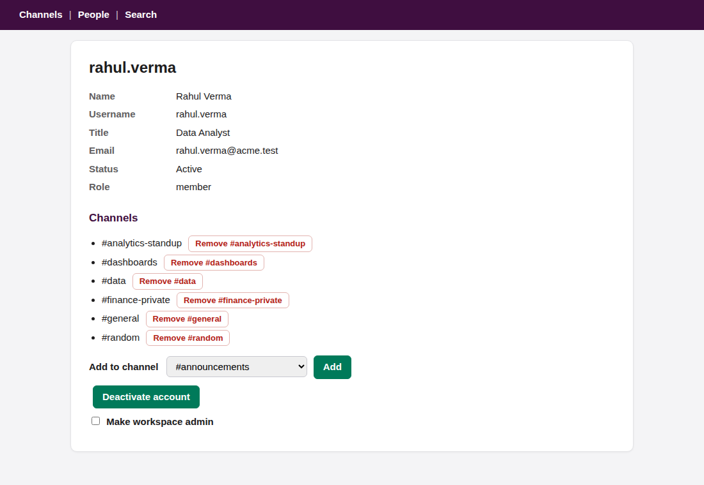

# Rung: an AI operator that finishes company tasks and proves it

**Rung** takes a short request from an employee ("Please onboard Priya, she's joining Monday") and turns it into finished, **verified** work across a company's apps: an HR system, a Slack-like chat, an SSO admin (stock Django), email, a shared Drive, and LibreOffice. It gets cheaper the more it works, because it learns direct API tools for the apps it first operates through their UI.

> **The model understands language. Code never does.**
> Code grounds what the model said against systems of record, runs routines already verified to work, and checks real state afterwards. The model can't approve itself, raise its own privileges, or declare a step done.

## Why this design

The brief asks for something narrow but genuinely autonomous. The expensive failure for an ops agent isn't "couldn't do it". It's **"said it was done, and it wasn't"**, or "did something nobody asked for". So Rung is built around **verified completion over improvisation**:

- **The model does what only a model can do:** read the request, judge which evidence matters, operate an unfamiliar UI, draft a procedure from prose.
- **Deterministic code does everything that must be right:**
  - resolve people and dates against HR;
  - check every proposed step against the app's real vocabulary, written policy and evidence trust;
  - re-read real state after every action;
  - undo completed work when a required step fails.
- **Anything uncertain becomes a question,** never a guess. Anything not allowed becomes a flag in the report. Nothing runs from a self-learned procedure until a human approves it.
- **Measured by false successes first.** An independent oracle reads the apps' databases, which the agent never can, and compares them with what the agent claimed.

## How it works

```
request ─► understand_request (MODEL: one typed call -> people, dates, task, intent, asks, open questions)
        ─► ground (CODE: HR records, ISO dates, e-mail syntax; ambiguous -> ask; several people -> one run each)
        ─► authorize (CODE: requester's authority from HR)
        ─► plan = procedure's fixed steps (YAML)
                + variable steps: evidence (peers, mail+trust flag, chat, SOP) -> MODEL proposes -> CODE validates
        ─► for each step (an expected state change), cheapest trusted interface first:
              already true? -> no-op
              learned API tool -> documented API / CLI -> UI exploration by the MODEL (traffic recorded)
              after a verified UI success: synthesize an API tool, sandbox-test it (do/verify/undo/verify), promote
              after every action: re-read real state; required step fails -> undo completed steps (saga)
        ─► report: what was understood and from where, what ran on which interface, how it was verified, flags
```

**Unknown task?** Rung doesn't improvise a plan:
1. It searches the Drive's `handbook/` and `templates/` and recent ops@ mail for a written how-to.
2. The model picks the relevant sources. Code rejects any untrusted mail or unshown id.
3. The model drafts a procedure, which is validated against what the apps can actually do.
4. Rung asks for approval. Once approved, the procedure becomes a reusable skill.

If nothing fits, Rung asks for directions.

Model calls are typed, pydantic-validated and retried with error feedback. Untrusted text goes inside `<data>` tags. The UI explorer may only type the values a task supplied, and `app.holds()`, not the model, decides when a step is done.

## See it run

[`docs/sample_report.md`](docs/sample_report.md) is the full output of `scripts/demo.sh` on the real model: a cold onboarding, a warm one, then the clock jumping to the start date. From the cold run's report:

```
| # | step                            | status    | how it ran                          | verified | notes                    |
| 2 | Create the Chatter account      | DONE      | explore:llm                         | verified | 22058 ms                 |
| 3 | Create the SSO (Acme SSO) login | DONE      | explore:llm                         | verified | 15390 ms                 |
| 5 | Add to #analytics-standup       | DONE      | explore:llm                         | verified | from precedent; 20197 ms |
| 6 | Add to #dashboards              | DONE      | learned:chat-synthesized_api-1a7462 | verified | from precedent; 67 ms    |
| 7 | Add to #data                    | DONE      | learned:chat-synthesized_api-1a7462 | verified | from precedent; 58 ms    |
| 12| Send the welcome email          | SCHEDULED |                                     |          | due 2026-10-12T09:00     |
Flags: untrusted mail from it-helpdesk@acme-support.test can't justify any step;
       peers suggest #finance-private, but policy FP-2 restricts it to Finance. Skipped.
```

The first channel add is done through the UI (20 s). Its recorded traffic becomes an API tool, which is sandbox-tested and then promoted, and the next channel adds take about 60 ms each with no browser. The cold run takes 82 s and 20 model calls; the warm run for the next hire takes 34 s and 6 calls. On Monday, `tick` sends the welcome emails and both runs end `done`.



*Chatter, the sandbox's Slack-like app, on the person page where Rung's explorer manages channel memberships (it learned that page from a verified change; see docs/DEVLOG.md). The styling is presentation only: the page text and elements the model reads are unchanged, and replaying recorded run A1 still matches with 0 misses.*

## Results

Real model: NVIDIA NIM `nvidia/nemotron-3-super-120b-a12b`.

| | result |
|---|---|
| **main eval**, 41 cases (commit `b701ec5`) | **0 false successes, 38/41 passed**, 368 model calls, 29 min |
| **replay** of that recording | reproduces it exactly: same 41 outcomes, **0 replay misses**, 6 min, no model calls |
| **skill search**, S1–S5 (latest code) | **5/5, 0 false successes**. In S4 the model picked an untrusted "how-to" trap mail with high confidence, and **code rejected it** |
| tests | 82 unit tests + 1 replay test pass |

The 41 cases cover:
- **learning curve:** a cold run explores the UI and learns API tools; the warm run uses them, with no browser for chat writes;
- **failure injection:**
  - the API moves (410);
  - sessions expire;
  - crashes mid-run, including right after a write;
  - a required step fails (the saga undoes the run);
  - UI redesigns;
  - an archived channel (409);
  - HR down;
- **ambiguity:**
  - two people with the same name;
  - a date that disagrees with HR;
  - no name given;
  - rehires;
  - "the new analyst";
  - "a week from Friday";
- **red-team:**
  - an injected admin request from a look-alike domain;
  - outsiders;
  - a spoofed e-mail From address, answered with a one-time code;
  - negated and cancelled requests;
  - garbage answers;
  - asks that policy refuses;
- **other task families:** offboarding (added as YAML only), a LibreOffice PDF report, and procedures drafted from prose SOPs.

The three failures, none of which claimed success:
- **B5.3:** the explorer couldn't add a channel on a redesigned UI it had never seen. The run was reported as partial.
- **C6:** the explorer couldn't disable a login in the Django admin. That's a required step, so the saga undid the completed steps.
- **R3:** the model read "Priya is joining Monday. karan.shah@acme.test too." as not a request. Nothing was done.

Per-case logs and every recorded prompt and answer are in `eval/`. The full story, including every bug found and fixed on the way, is in **[docs/DEVLOG.md](docs/DEVLOG.md)**.

## Limitations (honest)

- **One domain, three task families plus learned skills.** People ops is the proving ground: onboarding, offboarding, reporting, plus procedures drafted from SOPs. The core (ladder, verification, saga, grounding, validation) is app-agnostic, but breadth beyond that is not yet shown.
- **The sandbox apps are purpose-built stand-ins** (HR with OpenAPI, a Slack-like single-page app with CSRF and a versioned API, a Mailpit-style mailroom), written for real-app patterns. The SSO app is a stock Django admin Rung's author didn't write. LibreOffice, Chromium, SMTP and SQLite are real. LibreOffice runs through its own command line, not its GUI.
- **The explorer has gaps:** 9 of 11 UI changes on its benchmark. It can't disable a Django-admin login, or work Chatter's third UI variant.
- **The model is in the critical path.** If the model is down, requests escalate instead of degrading. A full suite on Nemotron takes about 30 minutes. Once tools are learned, warm runs make 2–6 model calls.
- **One model, one full recorded run.** Model answers vary between runs (R3 passed in the layer benchmark and failed in the eval), and run-to-run variance hasn't been measured.
- **Code can't check meaning.** It checks that a proposed step's values exist, its citations are real and trusted, and policy allows it. It can't check that a trusted message means what the model says. Precedent-based steps therefore need confirmation on first use.

## Run it

```bash
pip install -r requirements.txt                     # Python 3.11+; Playwright Chromium; LibreOffice + pdftotext
python -m sandbox.seed && PYTHONHASHSEED=0 python -m sandbox.run_all &
export RUNG_MODEL=nim NVIDIA_API_KEY=nvapi-...      # required: no offline mode (RUNG_MAX_RPM=18 by default)

python -m rung run "Please onboard Priya, she's joining Monday as a data analyst"   # --yes to auto-confirm
python -m rung clock 2026-10-12T09:30:00+05:30 && python -m rung tick              # jump to Monday
python -m rung run "Please give Kavya Reddy dashboard access"                      # unknown task: finds a how-to, asks
python -m rung inbox                                                                # answer requests e-mailed to ops@
python -m rung rungs; python -m rung events <run>                                   # learned tools; a run's full log

RUNG_RECORD=eval/model_run.jsonl python -m eval.run_eval --random 7                   # full eval, recorded
RUNG_MODEL=replay RUNG_REPLAY=eval/model_run.jsonl python -m eval.run_eval --random 7  # deterministic replay
python -m eval.run_eval --only S                                                     # skill-search cases only
python -m pytest -q tests
```

## Code map

| path | role |
|---|---|
| `rung/llm/calls.py`, `rung/llm/client.py` | typed model calls (understand, propose, find how-to, explore, draft); NIM client, rate limiter, recording, replay |
| `rung/ground.py`, `rung/understand.py` | grounding the model's reading against HR; orchestration and plan building over YAML procedures |
| `rung/precedent.py`, `rung/proposals.py` | evidence gathering (unfiltered, with trust flags); validation of model-proposed steps |
| `rung/howto.py`, `rung/procedures.py` | unknown tasks: source pick validation, drafting, the validator, drafts and approval |
| `rung/ladder.py`, `rung/promoter.py` | the interface ladder; UI traffic → sandbox-tested API tools; demotion only on interface drift |
| `rung/runtime.py`, `rung/policy.py` | run state machine, saga, checkpoints, scheduling; policy gate, requester authority |
| `rung/apps/*`, `rung/explore/*` | one adapter per app; headless browser with traffic capture; the guarded model explorer |
| `memory/` | procedures (YAML) and written policy |
| `sandbox/`, `eval/` | the sandbox company with failure injection; the eval, oracle, layer benchmarks, results and recordings |
| [`docs/DEVLOG.md`](docs/DEVLOG.md) | how this version was built: design decisions, every bug found and fixed, benchmarks, full results |
